<p align="center">
  
</p>

<h1 align="center">BrowserOS</h1>

<p align="center">
  A desktop environment that runs entirely in a browser tab.<br>
  Windows, a persistent file system, and fifteen applications, written in plain HTML, CSS, and JavaScript.
</p>

<p align="center">
  <a href="docs/USER_GUIDE.md">User guide</a> ·
  <a href="docs/INSTALLATION.md">Install and deploy</a> ·
  <a href="docs/ARCHITECTURE.md">Architecture</a> ·
  <a href="docs/RELEASE_NOTES.md">Release notes</a>
</p>

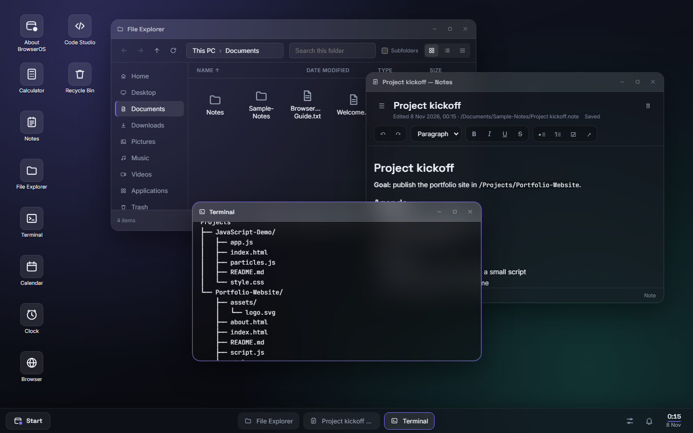

BrowserOS is a browser-based operating-system environment, not an
operating system for your computer. It runs inside one browser tab and
stores everything in that browser: a file system with folders and
Trash, a window manager, a taskbar and Start menu, notifications, and
applications from a file manager and terminal to a web browser and a
code editor with live preview. There are no frameworks, no
dependencies, no build step, and no server.

**Version 16.0** · released 7 November 2026 ·
1,073 automated checks passing in Chromium

## Contents

- [Screenshots](#screenshots)
- [Features](#features)
- [Applications](#applications)
- [Getting started](#getting-started)
- [Development](#development)
- [Architecture](#architecture)
- [Technology](#technology)
- [Known limitations](#known-limitations)
- [Security](#security)
- [Project status](#project-status)
- [License](#license)

## Screenshots

| | |
| - | - |
| 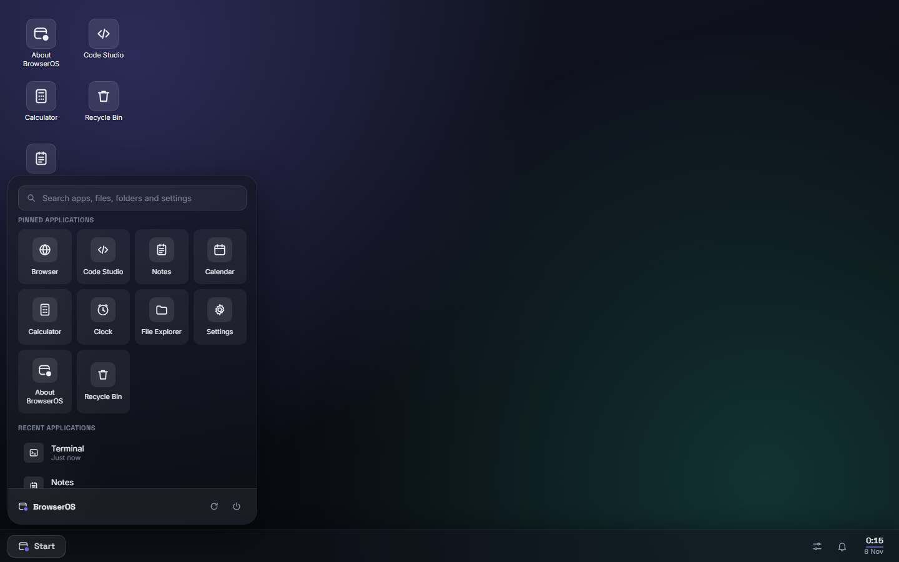 | 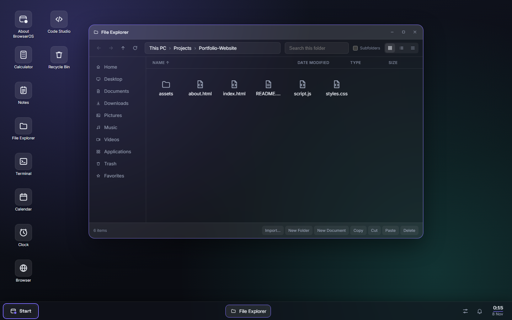 |
| **Start menu** | **File Explorer** |
| 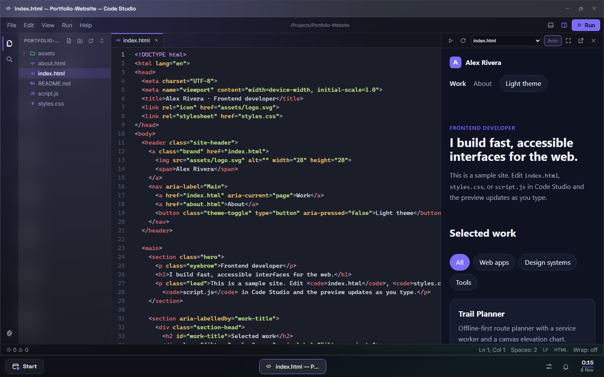 | 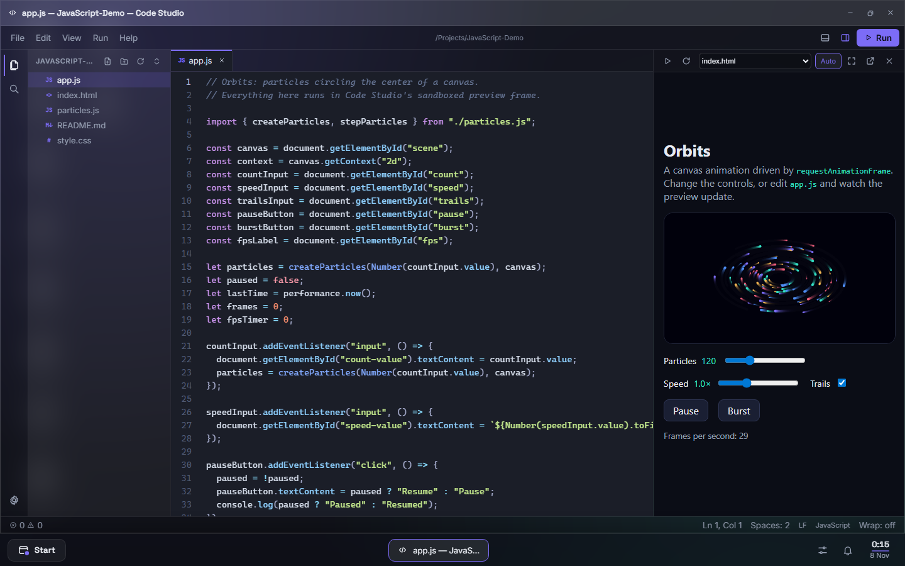 |
| **Code Studio** | **A running JavaScript project** |
| 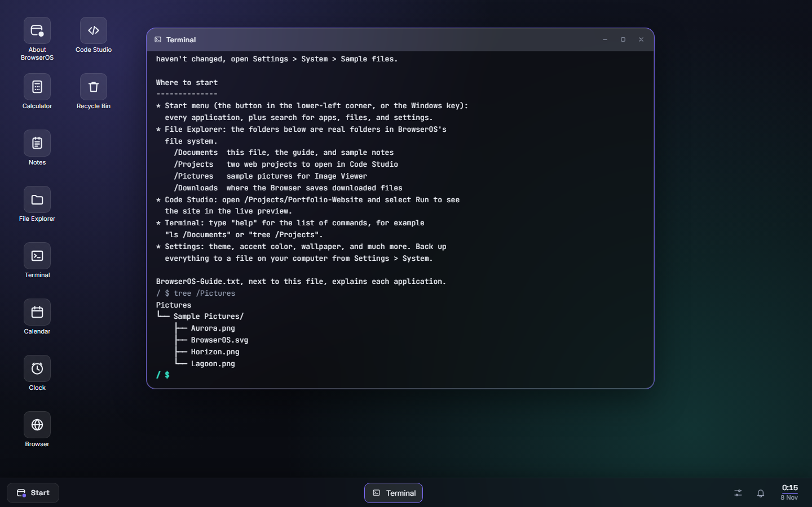 | 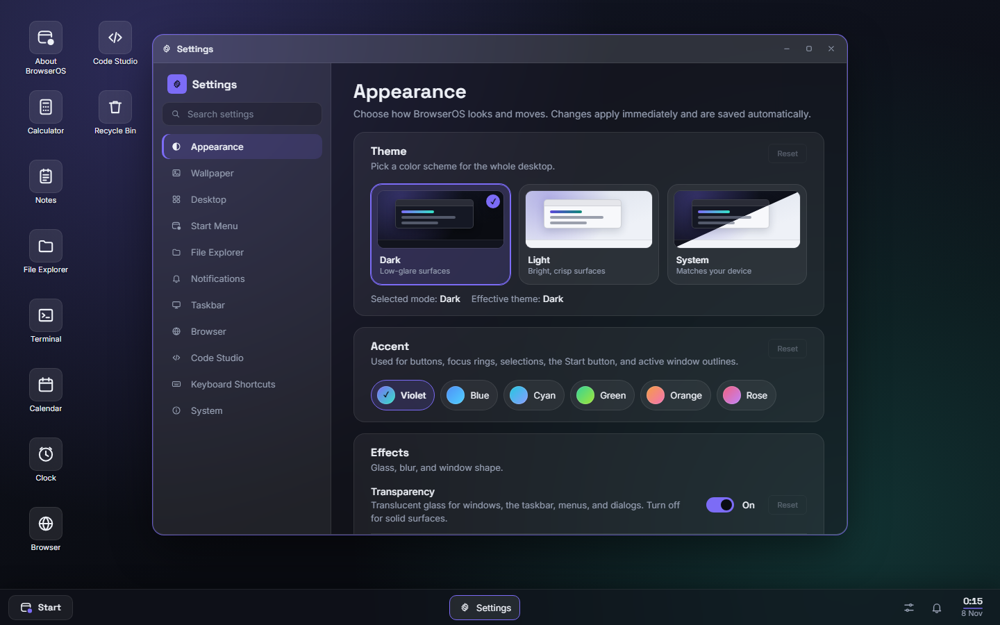 |
| **Terminal** | **Settings** |
| 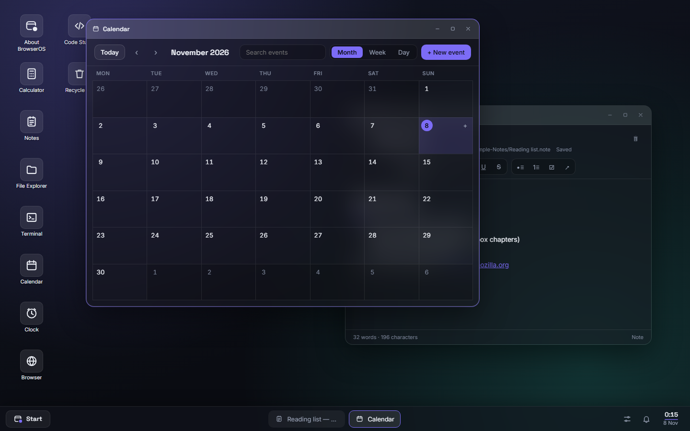 | 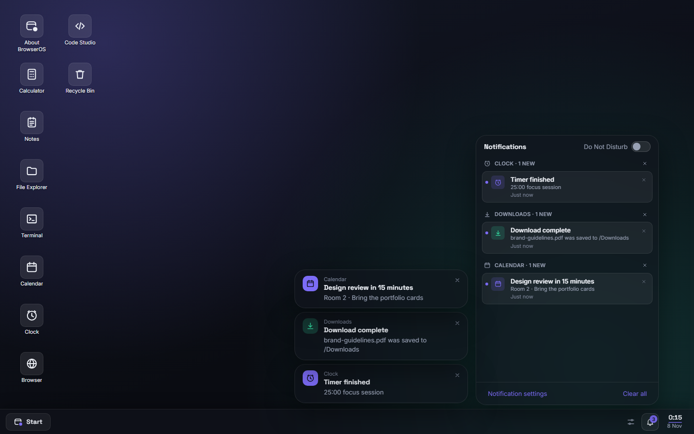 |
| **Notes and Calendar** | **Notification Center and system tray** |
| 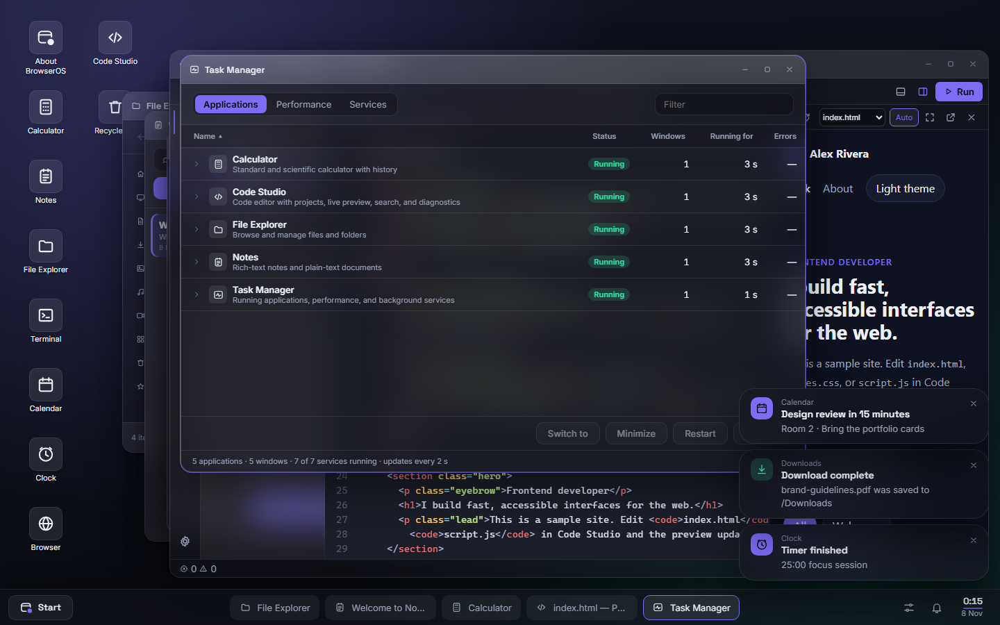 | 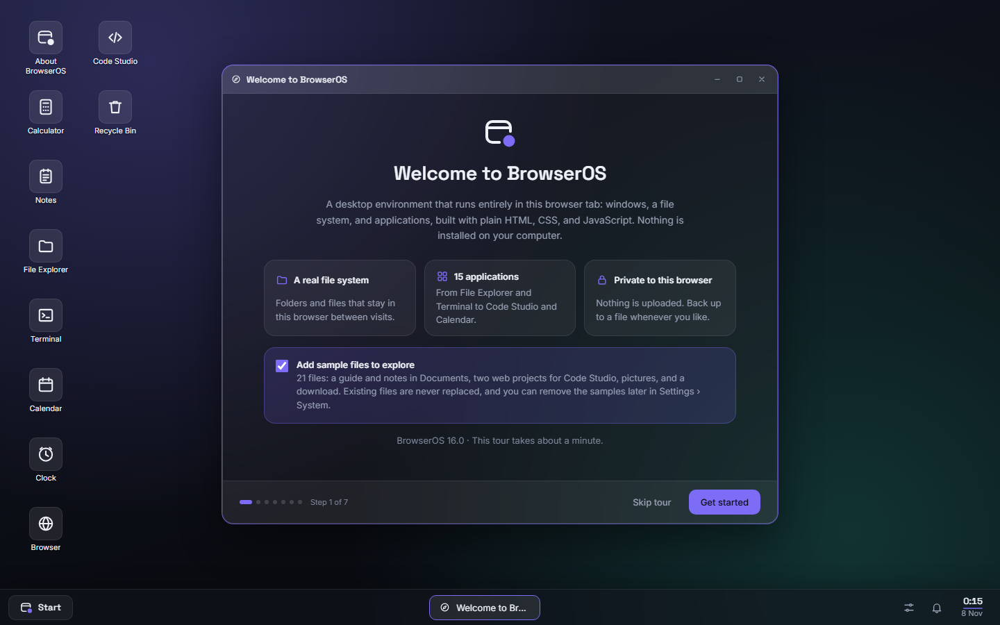 |
| **Task Manager** | **Welcome tour** |
| 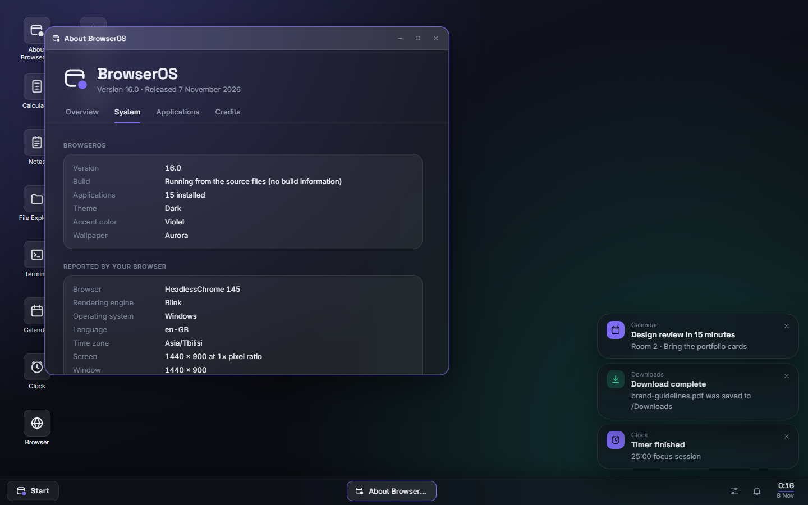 | 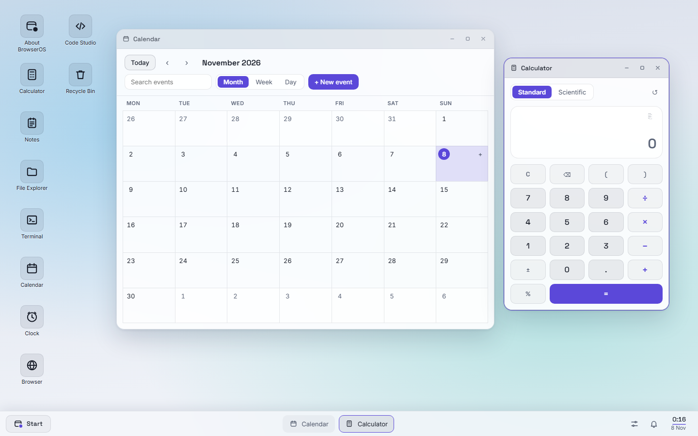 |
| **About BrowserOS** | **Light theme** |

All screenshots are of BrowserOS running, captured by
[`tests/screenshots.py`](tests/screenshots.py) in a fresh browser
profile with the built-in sample files.

## Features

- **A real file system.** Files and folders, text and binary, stored in
  IndexedDB behind one API that every application uses. Writes are
  confirmed only once stored, folder operations are all-or-nothing,
  and deleted items go to a Trash with restore.
- **Desktop and windows.** Overlapping, resizable windows with
  maximize, minimize, keyboard switching, and a taskbar that groups
  windows by application; desktop icons with selection, drag and drop,
  clipboard, and auto-arrange.
- **Applications that work together.** Files open in their registered
  application from anywhere, Terminal and Code Studio share the same
  files, the Browser downloads into `/Downloads`, and notifications open
  what they refer to.
- **Code Studio**, an editor for HTML, CSS, and JavaScript projects with
  syntax highlighting, diagnostics, project search, an integrated
  terminal, and a live preview that runs pages in an isolated frame.
- **A first-run experience.** A start-up screen that reports real
  progress, a Welcome tour for theme, accent, and wallpaper, and
  optional sample files: documents, notes, two web projects, and
  pictures.
- **Personalization.** Dark and light themes, six accent colors,
  wallpapers, transparency, motion, desktop layout, Start menu,
  keyboard shortcuts, and more, applied live and searchable in
  Settings.
- **Your data stays yours.** Everything is stored in your browser;
  back up everything or one folder to a validated file and restore it
  anywhere.
- **Background services** for notifications, calendar reminders,
  alarms and timers, downloads, and health monitoring, visible in Task
  Manager.

## Applications

| Application | What it does |
| ----------- | ------------ |
| File Explorer | Browse, search, sort, create, rename, copy, move, import, and delete files; favorites; grid, list, and details views |
| Terminal | A command line for the file system: `ls`, `cd`, `cat`, `mkdir`, `touch`, `echo > file`, `cp`, `mv`, `rm`, `tree`, `restore`, `purge`, `open`, `code`, `download`, with completion and history |
| Code Studio | Projects from templates, highlighting for HTML, CSS, JavaScript, JSON, and Markdown, find and replace, project search, Go to file, diagnostics, live preview, integrated terminal |
| Browser | Tabs, bookmarks, history, private tabs, a start page, and downloads into BrowserOS, within the limits of what embedded pages allow |
| Notes | Rich-text notes with checklists and links, and plain `.txt` and `.md` documents |
| Calendar | Month, week, and day views, recurring events, and reminders |
| Clock | World clock, alarms, stopwatch, and timer |
| Calculator | Standard and scientific modes with history; expressions are parsed, never evaluated as code |
| Image Viewer | PNG, JPEG, WebP, GIF, and SVG with zoom, rotation, and fullscreen |
| Downloads | Progress and history of downloads into `/Downloads` |
| Task Manager | Running applications, responsiveness, errors, and background services |
| Recycle Bin | Restore, permanently delete, or empty the Trash |
| Settings | Every preference, searchable, plus backup and restore |
| About BrowserOS | Version and build, browser-reported system information, applications, credits |
| Welcome | The first-run tour, available again at any time |

The taskbar's system tray adds the Notification Center, Quick Settings,
and a date panel.

## Getting started

BrowserOS is a set of static files. Serve the repository with any
static server and open it in a browser:

```sh
git clone https://github.com/LukaLomadze1/BrowserOS.git
cd BrowserOS
python tools/serve.py        # then open http://127.0.0.1:8000/
```

Opening `index.html` from disk doesn't work (browsers don't load
JavaScript modules from `file://`). Use `localhost` or HTTPS: the
single-tab guard and backup checksums need a secure context.

To publish it, build the production copy and upload `dist/` to any
static host:

```sh
python tools/build.py        # writes dist/ and checks every reference in it
```

[docs/INSTALLATION.md](docs/INSTALLATION.md) has step-by-step
instructions for GitHub Pages (a workflow is included), Netlify, and
Cloudflare Pages, plus headers, caching, and troubleshooting. The
[user guide](docs/USER_GUIDE.md) explains everyday use, and
[docs/DEMO_SCRIPT.md](docs/DEMO_SCRIPT.md) is a two-to-three-minute
tour for a demonstration.

## Development

There is nothing to install or compile: edit a file and reload the
page. The developer console can reach the core services:

```js
await vfs.createFolder("/Documents/Ideas");
appManager.launch("settings", { page: "appearance" });
settingsService.set("appearance.theme", "light");
```

Run the tests (Python 3.9+ and Playwright):

```sh
pip install playwright
python -m playwright install chromium
python tests/run_all.py               # unit tests and every end-to-end suite
python tests/run_all.py --site dist   # the same suites against the production build
```

Each suite uses its own local server and a fresh browser profile, so
your own BrowserOS data is never touched. See
[docs/TESTING.md](docs/TESTING.md) and
[CONTRIBUTING.md](CONTRIBUTING.md).

## Architecture

```
index.html, 404.html   the page (with the start-up screen) and the not-found page
src/main.js            start-up: services, application registration, the desktop
src/core/              system services: windows, applications, the file system (vfs/),
                       settings, keyboard shortcuts, notifications, background services,
                       backup, sessions, sample content, browser data, calendar and clock
src/components/        shared UI: windows, dialogs, menus, Start menu, tray panels
src/apps/<name>/       one folder per application, loaded the first time it opens
styles/                design tokens, shared controls, and shell styles
assets/                fonts (with their licenses) and brand images
tools/                 build.py (production copy) and serve.py (local static server)
tests/                 unit tests (in the browser) and end-to-end suites (Playwright)
```

- Applications extend `Application`, are registered once with
  `AppManager`, and get their windows through it; none of them touches
  the window manager or another application directly.
- Modules talk through a small event bus (`"domain:action"` events).
- All file access goes through the `vfs` API; only
  `src/core/vfs/storageAdapter.js` opens IndexedDB.
- One `SettingsService`, with a schema, migrations, and validation, owns
  every preference.
- One design system: tokens in `styles/variables.css`, one line-icon
  set, shared controls, light and dark themes designed separately.

[docs/ARCHITECTURE.md](docs/ARCHITECTURE.md) covers every service, the
application lifecycle, how to build an application, Code Studio's editor
and preview, persistence, the design system, deployment, and every
event.

## Technology

| | |
| - | - |
| Language | JavaScript (ES2022 modules), HTML, CSS (custom properties, container queries, `:has()`) |
| Storage | IndexedDB (file system), localStorage (settings and small state) |
| Browser APIs | Web Locks, BroadcastChannel, Web Crypto, Storage, Fetch, Canvas, `inert`, sandboxed iframes |
| Fonts | Inter, Space Grotesk, JetBrains Mono (SIL Open Font License 1.1, served with BrowserOS) |
| Dependencies | None at run time. The tools and tests use Python 3.9+; the tests also use Playwright. |

## Known limitations

- It is a web page: it can't access your computer's files, hardware,
  or other programs, and it works only while its tab is open (alarms and
  reminders can't fire when BrowserOS is closed).
- Data is stored per browser and per site address and isn't synced;
  clearing site data erases it. Back up from Settings › System.
- Many websites refuse to be shown inside another page, so the Browser
  opens them in a tab of your own browser instead; embedded pages from
  other sites can't be read or scripted.
- Code Studio has no Node.js, package manager, or server; it runs
  HTML, CSS, and JavaScript in the preview. Files of several megabytes
  are slow to edit.
- Tested in Chromium-based browsers only; Firefox and Safari are
  untested. Screen-reader support has been reviewed in the markup but
  not tested with a screen reader.
- There is no text-size setting; browser zoom enlarges everything.

The complete list is in
[docs/FINAL_RELEASE_REPORT.md](docs/FINAL_RELEASE_REPORT.md#known-limitations).

## Security

BrowserOS runs untrusted content (web pages, previews of user code,
imported files) only in sandboxed frames or as inert data, never with
access to its own origin; it uses no `eval`, never builds HTML from user
content, and makes no requests to other sites except on the user's
behalf in the Browser and Downloads. Data is not encrypted at rest.
[docs/SECURITY.md](docs/SECURITY.md) describes the threat model,
isolation boundaries, response headers, and how to report a
vulnerability.

## Project status

BrowserOS 16.0 is feature-complete for its scope and maintained for
fixes. There is no roadmap of new applications; changes now focus on
correctness, accessibility, and browser compatibility. Release history
is in [docs/RELEASE_NOTES.md](docs/RELEASE_NOTES.md), and the release
assessment in
[docs/FINAL_RELEASE_REPORT.md](docs/FINAL_RELEASE_REPORT.md).

## License

No license has been published for BrowserOS's own source code yet, so
all rights are reserved by its author until one is added. The bundled
fonts are licensed separately under the SIL Open Font License 1.1 (see
`assets/fonts/`).
